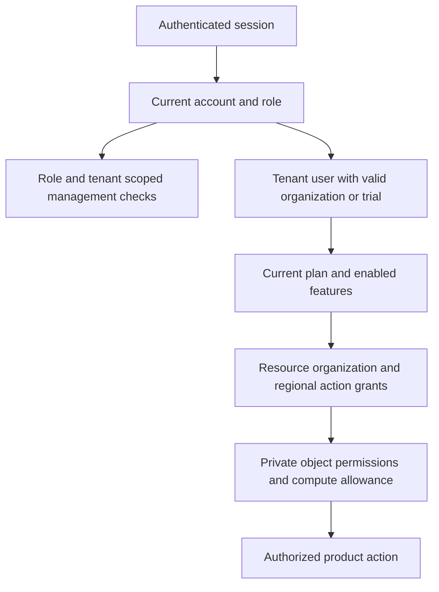

# Digital Twin roles and permissions feature plan

Status: Web implementation complete in source; deployment acceptance pending  
Date: 2026-11-05  
Scope: Digital Twin account administration, product entitlements, and resource authorization

Digital Twin should follow iPSS's account roles, management boundaries, plan inheritance, and access lifecycle. Platform staff manage the service; tenant administrators manage their organization's people; tenant users use the product. Product access also requires an eligible account, a valid organization or trial, an enabled plan feature, and authorization for the requested resource and action.

The user selected iPSS behavior as the implementation baseline. Tenant administrators receive administrative access only; someone who also needs to use Digital Twin needs a separate product account. Web accounts and administration are implemented across the frontend and Engine. Desktop trial licensing remains the later slice.

The source includes live account/plan authorization, separate administrative workspaces, durable invitations and activation, required TOTP plus email approval of sensitive writes, tenant departments/users, web trial intake/review/provisioning, extensions and cumulative compute accounting. Schema installation, initial administrator binding, SES configuration and deployed acceptance remain release steps; see Engine `docs/operations/accounts.md`. Storage allowances are displayed, matching the reference behavior; upload admission does not enforce storage consumption.

## Reference baseline

The supplied **iPSS user management and permissions manual**, based on its October 30, 2026 working tree, is the behavioral reference. Repository references below are pinned to inspected iPSS commit `cfb3fb13c30b8799fb70f0eda2ad05be076a5696` on `main`.

| Reference | What it establishes |
| --- | --- |
| [User management requirements](https://github.com/WattByte-Nexus/IPSS-Web-App/blob/cfb3fb13c30b8799fb70f0eda2ad05be076a5696/unified-upms/docs/user-management-requirements.md) | Role separation, review ownership, invitations, public application intake, and MFA requirements |
| [Access plans](https://github.com/WattByte-Nexus/IPSS-Web-App/blob/cfb3fb13c30b8799fb70f0eda2ad05be076a5696/unified-upms/docs/access-plans.md) and [implementation](https://github.com/WattByte-Nexus/IPSS-Web-App/blob/cfb3fb13c30b8799fb70f0eda2ad05be076a5696/unified-upms/src/main/java/com/unified/upms/admin/domain/management/AccessPlans.java) | Live plan inheritance, Trial and Standard behavior, limits, and protected plan deletion |
| [Tenant administration](https://github.com/WattByte-Nexus/IPSS-Web-App/blob/cfb3fb13c30b8799fb70f0eda2ad05be076a5696/unified-upms/docs/tenant-administration.md) and [implementation](https://github.com/WattByte-Nexus/IPSS-Web-App/blob/cfb3fb13c30b8799fb70f0eda2ad05be076a5696/unified-upms/src/main/java/com/unified/upms/admin/domain/management/TenantAdministration.java) | Tenant isolation, departments, user maintenance, and exclusion of administrators from product roles |
| [Account eligibility and feature resolution](https://github.com/WattByte-Nexus/IPSS-Web-App/blob/cfb3fb13c30b8799fb70f0eda2ad05be076a5696/unified-upms/src/main/java/com/unified/upms/admin/domain/management/ManagementService.java) | Role checks, account/trial validity, and last active platform administrator protection |
| [Tenant extensions](https://github.com/WattByte-Nexus/IPSS-Web-App/blob/cfb3fb13c30b8799fb70f0eda2ad05be076a5696/unified-upms/docs/tenant-access-extension.md), [trial extensions](https://github.com/WattByte-Nexus/IPSS-Web-App/blob/cfb3fb13c30b8799fb70f0eda2ad05be076a5696/unified-upms/docs/trial-extensions.md), and [MFA](https://github.com/WattByte-Nexus/IPSS-Web-App/blob/cfb3fb13c30b8799fb70f0eda2ad05be076a5696/unified-upms/docs/mfa-rollout.md) | Restricted access after tenant expiry, separate extension decisions, and verification for sensitive changes |
| [Current Cognito operations](https://github.com/WattByte-Nexus/IPSS-Web-App/blob/cfb3fb13c30b8799fb70f0eda2ad05be076a5696/infra/cognito/Cognito-Dev-Operations.md) and [Cognito integration](https://github.com/WattByte-Nexus/IPSS-Web-App/blob/cfb3fb13c30b8799fb70f0eda2ad05be076a5696/infra/cognito/README.md) | Current Cognito login with required authenticator-app MFA; UPMS retains account policy, provisioning, and email verification for management actions |

Some earlier iPSS requirements describe reviewer-selected trial features, individual resource overrides, and legacy email MFA at login. The newer plan code and Cognito operating documents supersede those paths: Trial uses its plan, ordinary tenant users inherit their organization's plan, and Cognito owns login with authenticator-app MFA. Sensitive management actions retain application-owned email verification. Digital Twin should implement that current model. iPSS also retains legacy fallback code; that is not part of the proposed Digital Twin design. Repository deployment instructions are reference material and do not authorize deployments or changes to iPSS.

## Current Digital Twin implementation

| Boundary | Earlier behavior | Implemented behavior |
| --- | --- | --- |
| [Frontend access contract](../apps/geolibre-desktop/src/product-modes/digital-twin/access.ts) | Five operational personas, three coarse workspace capabilities, mandatory organization | Singular iPSS account role, tenant-free staff, eligibility, current plan and exact resource actions |
| Engine `src/api/hosting.py` | Cognito group admitted a fixed organization with blanket regional grants | Authoritative account/organization policy on each protected request; no group-based grant path |
| Engine `src/api/access.py` | Enforces typed, server-owned grants such as `region:read`, `assets:write`, `runs:submit`, and `runs:cancel` | Keep this enforcement boundary; resolve its grants from tenant membership, plans, resource ownership, and action policy |
| [Administration landing](../apps/geolibre-desktop/src/product-modes/digital-twin/AdministrationLanding.tsx) | Regional data management behind a broad administration capability | Account-role management panels; product data authoring uses its own `/data` route and concrete permissions |
| Engine session and data stores | Runtime uses DynamoDB browser sessions, Aurora asset/catalog authority, DynamoDB operational state, and private S3 objects | Reuse existing ownership boundaries; add durable account policy without moving identity into browser state or worker internals |
| [Pilot workflow contract](pilot-workflow-contract.md) | Operational personas and Entra identity default | Cognito, iPSS account roles, no admin product inheritance; future supervisor-specific decisions require explicit policy |

The older Engine access operations document and Cognito ADR describe Redis sessions and EC2 topology. Current `hosting.py` and `ARCHITECTURE.md` establish DynamoDB sessions; deployment planning must use the current runtime and hosting configuration. Local observations reflect frontend HEAD `4c3d2618` and Engine HEAD `8e9c30a` plus their inspected working trees.

## Roles and management authority

Use predefined account roles with no custom role editor. Each account has one selected account role. Web trials are `TENANT_USER` accounts with a trial record and Trial plan, not a separate role.

| Account role | Scope | Permitted responsibilities | Product access from this role |
| --- | --- | --- | --- |
| `PLATFORM_SUPER_ADMIN` | Platform staff, no customer tenant required | Manage administrative staff; create organizations and their first tenant administrator; manage plans, platform feature availability, and organization extensions | None |
| `WEB_TRIAL_ADMIN` | Web trial staff, no customer tenant required | Review web applications; provision/directly create web trials; manage invitations, trial suspension, and trial extensions | None |
| `DESKTOP_TRIAL_ADMIN` | Desktop trial staff, later phase | Review desktop applications and deliver approved external licenses | None; delivery creates no web account |
| `TENANT_ADMIN` | One non-trial customer organization | Create/manage ordinary users and departments; request an organization extension | None |
| `TENANT_USER` | One customer organization or web trial | Use purchased/enabled product features within authorized resource scope; inspect own usage | Plan-dependent |

| Action | Platform admin | Web trial admin | Desktop trial admin | Tenant admin | Product user |
| --- | --- | --- | --- | --- | --- |
| Create, change role, suspend, or invite administrative staff | Yes | No | No | No | No |
| Create organization and first tenant administrator | Yes | No | No | No | No |
| Create/edit/suspend ordinary tenant users | No through tenant workspace | No | No | Own organization | No |
| Manage departments | No through tenant workspace | No | No | Own organization | No |
| Manage plans, feature catalog, CPU/storage allowances | Yes | Read Trial summary only | No | No | No |
| Review/provision web trials | No | Yes | No | No | No |
| Review/deliver desktop trials | No | No | Yes | No | No |
| Decide web trial extension | No | Yes | No | No | No |
| Decide organization extension | Yes | No | No | Request only | No |
| Use Digital Twin or private customer data | No automatic access | No automatic access | No automatic access | No automatic access | Authorized resources and plan features |

Platform administration does not imply trial-review authority or customer-data access. Tenant administrators cannot promote users, create another administrator, change email through ordinary user maintenance, set someone else's password, delete users, or assign individual feature/quota overrides. Platform creation of additional tenant administrators beyond the initial administrator needs a separately defined workflow before exposure.

The last active platform administrator cannot be suspended or demoted, including under concurrent requests. Suspending a reviewer or removing its review role releases its undecided applications. Changes take effect in authorization without waiting for an existing one-hour login session to expire.

## Product entitlements and resource access

The proposed authorization sequence is:

1. Authenticate the principal and resolve a current, activated, unsuspended account.
2. Authorize the requested management action from the account role, or require `TENANT_USER` for product access.
3. For product requests, require an enabled/effective organization and unexpired organization or activated trial.
4. Resolve the current plan against the enabled product feature catalog.
5. Resolve the resource's authoritative organization, allowed region, and any private object/dataset permission.
6. Require the concrete action and, for new compute work, available allowance.

The API enforces every step. Navigation, hidden controls, browser settings, directory nodes in a permission tree, and possession of a URL never grant access. Collection filtering, individual reads, mutations, exports, SSE, tiles, point-cloud bytes, and upload completion all need the corresponding server checks. Resource ownership comes from durable records, not a caller-supplied organization ID. Existing private point-cloud grants remain an additional requirement.

### Plan behavior

| Plan | Features | Editable by platform administrator |
| --- | --- | --- |
| Trial | All enabled customer product features, including AI and future enabled customer features | CPU/storage allowances |
| Standard | All enabled non-AI customer product features | CPU/storage allowances |
| Custom tenant plan | Explicit selection from enabled customer product features | Name, feature selection, CPU/storage allowances |

Trial and Standard have fixed identities, names, and feature rules and cannot be deleted. A custom plan cannot be deleted while referenced by any organization, including an archived organization. Trial is reserved for web trials. Feature edits apply on subsequent access checks. Plan changes, extensions, and job deletion never reset consumed CPU.

Keep management actions outside the customer product catalog, so Trial's inclusion of future enabled product features cannot grant staff authority. Maintain concrete action codes and server-validated prerequisites; never use wildcard or parent-menu permission checks as executable authority.

### Digital Twin permission mapping

These are proposed Digital Twin feature areas, not copies of iPSS's electrical-analysis permission names. Reuse existing Engine action codes where they already describe the operation.

| Product area | Required authorization |
| --- | --- |
| Regional map, assets, weather, replay, and evidence | Enabled read feature plus exact `region:read` scope; private resources also require their own grants |
| Scenario creation | Enabled scenario feature plus `scenarios:create` for the target region |
| Simulation submission | Enabled simulation feature plus `runs:submit`, valid inputs, and compute allowance |
| Simulation cancellation | Separate `runs:cancel` action for the authoritative run region and approved run ownership policy |
| Regional data creation/edit/publication | Existing `region:create`, `region:write`, `region:publish`, `assets:write`, and `surveys:submit` as appropriate; do not derive them from account-administration access |
| Expert GIS | Enabled expert-workspace feature; individual reads/writes/exports still need their own actions |
| Export and sharing | Explicit export/share action and authorized source resources; a share cannot exceed the recipient's tenant/resource access |
| AI | Enabled AI feature plus permission to every input resource used by the AI operation |
| Operational alert decisions | Preserve the pilot's action restrictions until an explicit operational policy replaces them |

Under the iPSS baseline, all ordinary users in one organization receive the same plan features. Departments are organizational labels and do not change entitlements. Platform administrators assign the organization's region scope during setup; narrower user-level region assignments require a concrete customer requirement before adding another grant editor. Every region must have an authoritative tenant owner or an explicitly modeled shared-resource policy before multi-tenant release; globally listing the existing catalog is insufficient.

The existing operator/supervisor/engineer/analyst names should not become extra account-management roles. They may remain descriptive personas. However, iPSS's five account roles do not express supervisor-only operational decisions. Until that policy is resolved, do not enable such actions for every `TENANT_USER`, and do not infer them from a job title or plan purchase. Raw exports and regional publication similarly need an explicit policy where the pilot requires narrower grants.

## Account and trial workflows

### Organizations and ordinary users

A platform administrator creates an organization with its name, tenant plan, access duration, authorized regions, and initial administrator's name/email. Default organization duration is 365 days. Persist the organization, invited administrator, and provisioning/outbox intent together. Identity-provider and email delivery happen idempotently after that transaction; failures remain visible and retryable without creating duplicate accounts.

The tenant administrator activates its invitation, creates a department, and invites ordinary users with first name, last name, email, and department. Users inherit the current organization plan after activation. Editing a user's name or department does not change its role. Suspension revokes access; reactivation still requires completed activation and valid organization access.

Department names are unique within an organization after trimming and case normalization. Renaming preserves assignments. Deletion is blocked while any user is assigned, including suspended users. Tenant admins see ordinary users only, with independent invitation and suspension states.

### Web trials

Public intake creates an application and receipt without creating an account or tenant. Enforce rate limits and duplicate handling without disclosing existing account status. A reviewer explicitly claims a request; viewing it or opening an email link has no ownership effect. Only the current eligible owner may decide, provision, or change the application's access workflow. Release and transfer are explicit; concurrent claims have one winner. Notify the owner once at seven days of an undecided review cycle without automatically releasing it.

Approval and provisioning are distinct steps. Review recipient, duration, Trial plan summary, and invitation before confirming account creation. Provision one invited `TENANT_USER` and trial organization; start the trial duration at activation. Support direct trial creation through the same plan, invitation, validity, and audit rules. Reject with a reviewed response and no account creation.

Any eligible web reviewer may manage existing trials through the trial-user list and decide extension requests, independent of original review ownership. Application-specific mutations remain owner-scoped. Activated users use password recovery; pending invitations may be resent. An expired trial must be extended before reactivation.

### Extensions and restricted access

A tenant admin may have one pending organization extension request with an optional message. The platform admin approves or rejects it; rejection requires a reason. Approval adds the requested duration to the existing future deadline, or to the approval instant if already expired. An expired tenant admin may sign in only to access status, extension, and required verification screens; ordinary tenant users receive no expiry exception.

An activated, eligible web trial user may request a later expiry before current expiry, with an explanation of up to 2,000 characters. One request may be pending per user. Any active web trial admin may decide it; both approval and rejection require a message, and approval must set a future deadline later than the current expiry. Expired trial users require reviewer assistance.

Activation, suspension, password setup, organization validity, trial expiry, and allowance exhaustion remain separate fields/conditions. Show actionable reasons rather than a single ambiguous Active badge.

### Compute and storage

Mirror iPSS's cumulative per-user compute policy: its documented CPU hours are elapsed job wall time, not processor utilization or core-hours. The Engine owns idempotent usage accounting and admission/stopping behavior; the UI displays those results. Use atomic admission/reservation and durable accounting so simultaneous submissions cannot overspend an allowance. System-driven stops must remain possible after user access is revoked or allowance is exhausted.

Use iPSS's checked-in initial values for Trial and Standard: 20 cumulative compute hours and 500,000,000 storage bytes per user. These are editable seed values, not a claim about live iPSS plan settings. Existing configured plan values must survive repeated initialization. Define attribution for region-wide autonomous runs separately from a person's manual simulation budget. Do not charge them implicitly to a tenant administrator. Extending time or raising a plan limit does not restart stopped work automatically.

For initial iPSS parity, storage allowance is configured/displayed, with the UI clearly identifying whether upload admission is enforced. iPSS's current documentation does not claim storage-based upload blocking. Enforced Digital Twin storage admission would be an explicit additional capability with reservation and upload-finalization checks.

## Application surfaces

| Surface | Contents |
| --- | --- |
| Platform administration | Administrative staff, organizations and initial administrator invitations, plans/features/allowances, organization extension decisions |
| Web trial administration | Application queue/detail/history, explicit review ownership, provisioning review, trial users, invitations, extension decisions |
| Tenant administration | Organization summary, ordinary users, departments, invitation status, suspend/reactivate, request extension |
| Product account | Own organization/department where applicable, current plan, usage and expiry, trial extension request, password recovery and session controls |
| Restricted tenant access | Expiration explanation, organization extension status/request, verification and sign-out |
| Public application and credential entry | Trial intake/receipt and invitation/recovery entry points with their own server validation |

Signed-in administrators land in the app at `/home`, with preferences and account-role navigation at `/settings`. Administration is opened from Settings: `/admin` for staff and `/tenant-admin` for tenant administrators. Every administrative screen provides Back to app and a Settings breadcrumb. Entering the app shell does not grant customer-region or simulation permissions. Keep regional data administration in the product behind its concrete data actions. Product preferences remain separate from account administration. Return authenticated deep links to the authorized destination; preserve no sensitive payload in URLs.

Compose forms, tables, tabs, badges, dialogs, alerts, menus, and permission trees from existing `@geolibre/ui`/shadcn components. Shared compositions belong in `packages/ui`; workflow orchestration belongs in the Digital Twin app. Use semantic theme tokens, the shared glass treatment for application chrome/portals, light/dark support, keyboard interaction, clear focus, and reduced motion. Each management surface needs loading, empty, unavailable, denied, validation, stale-edit, success, and delivery-failure states.

## Backend and contract ownership

Keep authentication and account-policy resolution at the existing trusted Engine HTTP hosting boundary. Organize management handlers, account-policy services, and persistence within the existing API/services/state packages; numerical engines and the local GeoLibre processing sidecar must not own accounts. Use the existing relational persistence boundary for organization/user/department/plan relationships and transactional management/outbox records, with an ADR documenting schema ownership and tenant constraints. Keep existing DynamoDB browser sessions.

Continue using the current Cognito login flow and opaque cookie session. Replace the group admission shortcut with authoritative account eligibility. Store authentication identity in sessions and resolve current authorization on protected requests; do not keep role/plan/tenant grants as an immutable login-time snapshot. Suspension, role changes, expiry, and plan edits must invalidate authorization for subsequent requests. Streams need bounded reauthorization/disconnection, and browser state must clear inaccessible data when access changes.

Extend the existing `/api/digital-twin/access` projection atomically with its consumers. It must support a tenant-free staff account, the selected account role, independent lifecycle restrictions, available workspaces, current product features, and exact region/action scope. Keep frontend capabilities as derived workspace navigation if useful; the three current booleans cannot authorize individual mutations. Administrative users need a landing page even when they have no organization or product regions. An expired tenant admin needs a valid restricted projection rather than an unrecoverable redirect loop.

Add typed management contracts for staff, organizations, plans, tenant users/departments, applications/provisioning, extensions, and own usage as each slice ships. Use version checks for conflicting edits, an idempotency key bound to actor/action/payload, and transactions for claims, final decisions, last-admin protection, and provisioning intent. A stale write returns a clear conflict; it never overwrites another administrator's edit. Retried email/provider operations reuse the existing intent.

Match iPSS's current Cognito verification policy: all roles require authenticator-app MFA at login, and sensitive management changes require application-owned fresh email verification; operations requiring individual approval use a short-lived, single-use proof bound to the session and action. A remembered login must not satisfy action approval. Retain server-side Origin checks and private/non-cacheable protected responses. Never put passwords, OAuth tokens, invitation secrets, MFA codes, or license contents in browser storage, public projections, or audit records. Check current Cognito configuration APIs before implementing pool changes; do not reproduce the retired custom Java login MFA flow.

Use append-only audit events for role/state/plan changes, invitations, review ownership, provisioning, and extension decisions, recording actor, target, organization where relevant, timestamp, version, and reason. Public application, sign-in, callback, and credential entry routes require explicit classification so the existing protected-route middleware does not block them. Public reachability does not bypass token checks, rate limits, or application authorization.

At cutover, explicitly provision the intended platform administrator and customer accounts, verify tenant ownership of existing resources, update callers/tests/docs together, and remove the blanket `nexus-administrators` grant branch and obsolete account-role assumptions. Preserve existing customer data through explicit ownership assignment. Do not add a legacy role mapper, planless-user fallback, or second authorization system.

## Delivery sequence and acceptance criteria

Slices 1–4 are implemented across the Engine and frontend. This records their
acceptance boundaries; deployment validation remains in the account operations
runbook. Slice 5 is deferred.

| Slice | Working outcome | Required verification |
| --- | --- | --- |
| 1. Scoped organization access | Platform bootstrap; protected Standard/Trial plan rules; one organization/first admin invitation; minimal ordinary-user invitation; assigned region access; staff and product landing pages | Two organizations cannot list/read/mutate each other's resources; no admin product inheritance; plan and account eligibility enforced by the API; no group blanket grant remains |
| 2. Complete tenant and platform administration | Staff invite/edit/suspend/resend; organization setup; departments; ordinary-user maintenance; custom plans and feature controls | Last-admin race protection; no promotion/email/password/delete controls in tenant maintenance; department constraints; idempotent invitations; plan inheritance and protected deletion |
| 3. Web trials and measured compute | Public application to explicit claim, review, provisioning, activation, and product access; direct trials; invitation delivery/status; cumulative compute admission/enforcement | Concurrent claim/provisioning tests; reviewer ownership; role-specific queues; no account before confirmation; activation-based expiry; quota concurrency and preserved usage |
| 4. Access extensions and lifecycle completion | Organization/trial extensions, expired-tenant-admin recovery, security verification, audit and notifications across all shipped actions | Correct decision authority; one pending request; date calculations; suspension distinct from expiry/invitation; current sessions/streams lose revoked access; real invitation/recovery/MFA delivery acceptance |
| 5. Desktop trials if included | Separate desktop team/queue, reviewed HTTPS download and external license delivery with visible retries | No web tenant/user provisioning; only owner mutates; nonempty license at most 1 MiB; idempotent delivery; safe attachment retention and audit |

MFA, audit, durable delivery, and request-time authorization are requirements of each slice that performs sensitive actions, not security work deferred until slice 4. Invitations require functioning activation/recovery and delivery before customer use. Public production trials require enforced compute accounting and extension/support paths. The complete web feature comprises slices 1–4.

Frontend access/transport tests, management browser workflows and Engine API/store
integration tests cover the implemented boundaries. SQL tests use an isolated
local PostgreSQL database; external identity/email calls use fake providers.
Hosted HTTP tests exercise the actual OAuth verifier, middleware, application
services and SQL authority. Live email/MFA acceptance and actual deployed iPSS
settings remain unverified.

## Accepted implementation decisions

| Decision | Selected baseline | Scope boundary |
| --- | --- | --- |
| Tenant admin product access | Confirmed by user: match iPSS with separate admin and product accounts | Combined access is outside this feature's accepted scope |
| Desktop workflow scope | Complete web feature first; desktop trial review/delivery later | Including desktop immediately adds license attachment handling, release/download policy, and a second review team |
| Shared iPSS identity or administration | Keep current Digital Twin Cognito hosting and authorization ownership; share behavior only | Shared accounts/SSO or reuse of UPMS needs an explicit cross-product identity/service contract; do not assume shared subjects, tenants, credentials, or databases |
| Operational authority | Use iPSS account roles; retain no extra operator/supervisor/engineer/analyst authorization roles | Existing supervisor-only actions remain unavailable until an explicit product action policy replaces that restriction |
| Allowance values and autonomous compute | Match iPSS initial seeds: 20 compute hours and 500,000,000 storage bytes per user for Trial/Standard | Autonomous service-run attribution still needs an explicit owner; it must not consume an administrator's personal allowance |

The [access projection](digital-twin-access-projection.md), [pilot workflow contract](pilot-workflow-contract.md), and [product requirements](digital-twin-product-requirements.md) describe the accepted role/identity/action policy. Operational personas carry no additional permissions.
