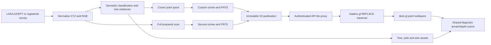

# Point-cloud performance, LOD, and risk coloring investigation

Investigated November 5, 2026. Frontend base: `4c3d2618`; Engine base: `8e9c30a`. Both working trees contain pre-existing changes, including the new full-scan/crown view. Findings refer to the files present during inspection, not a claim that every change is deployed. No application code or deployed resources were changed.

**Recommendation: keep the existing MapLibre/deck.gl scene, correct the LOD implementation, and let clouds that fit in one tile remain one tile. Preserve tree membership and analytical attributes through the pipeline to support risk colors. A renderer replacement is not required to address the strongest findings.**

The user's suspicion about LOD is supported by concrete reproductions: the installed traversal requests siblings serially, the builder forces small clouds into unnecessary hierarchies, and normal layer reconstruction drops the elevation used for detail selection. These are stronger evidence than a general claim that point-cloud rendering is inherently expensive.

The [open source comparison](point-cloud-open-source-options-2026-11-05.md) covers deck.gl, Potree, Giro3D, CesiumJS, COPC, PDAL, copc.js, laz-perf, py3dtiles, and the MapLibre LiDAR plugin with primary-source citations.

## Evidence and limits

- Read the active frontend renderer, scene composition, catalog polling, Engine ingestion/segmentation/tiling/publication/access paths, tests, and historical benchmark notes.
- Inspected installed deck.gl **9.3.6** and loaders.gl **4.4.3** source. The codebase graph tools were unavailable in this session, so discovery used repository searches and direct source reads.
- Ran isolated reproductions against the real installed traversal and layer methods, and synthetic clouds through the actual Engine octree builder.
- Ran the existing point-cloud catalog and LiDAR layer tests: **13 passed**. Their coverage does not exercise sibling request concurrency, root-leaf eligibility, or layer recreation after a catalog poll.
- The production browser reached **Sign in required**. No authenticated production HAR, GPU profile, frame-rate measurement, or comparative Neara benchmark was obtained. Reported microbenchmarks are local and explicitly scoped.
- The August Golden benchmarks describe older sources/build recipes. Their timings and point counts are useful history, not measurements of the current semantic/full-scan pipeline.

## Current architecture



The builder publishes crown tiles at `tileset.json` and the full prepared scan at `full/tileset.json`. Full scan is the selected representation when points are enabled; point clouds themselves default to hidden. Only the selected representation is rendered, so the two outputs increase build/storage work, not automatically simultaneous browser drawing.

The production policy sets 100,000 points per leaf and 50,000 per preview. Leaves preserve native points; parents duplicate sampled child points and use `REPLACE`. The payload is uncompressed float32 local ECEF XYZ plus uint8 RGB: **15 bytes per encoded point**, excluding small headers. A compressed upload's file size is therefore not its display-transfer size.

The current browser uses a single interleaved map/deck scene, binary point attributes, fixed pixel-radius circular points, no material lighting, and disabled point picking. It already avoids object-per-point React rendering. Its LOD configuration is screen-space error 8, nominal memory budget 256 MiB, request concurrency 8, debounce 16 ms, and static transforms. The radius value is 1; this is approximately a two-pixel diameter in the layer's pixel units, not a one-pixel-square primitive.

Sources: [builder.py](../../../Digital_Twin_Engine/src/data/normalization/point_clouds/builder.py), [octree.py](../../../Digital_Twin_Engine/src/data/normalization/point_clouds/octree.py), [pnts.py](../../../Digital_Twin_Engine/src/data/normalization/point_clouds/pnts.py), [production policy](../../../Digital_Twin_Engine/config/point_clouds.yaml), [digital-twin-lidar.ts](../../apps/geolibre-desktop/src/product-modes/digital-twin/digital-twin-lidar.ts), [SatelliteTerrainMap.tsx](../../packages/map/src/SatelliteTerrainMap.tsx).

## Ranked findings

### 1. Sibling refinement is effectively serial in the installed loader

**Confirmed by executing the installed `Tileset3DTraverser`. High priority for slow refinement.**

`updateAndPushChildren()` returns `false` inside the child loop as soon as it finds an unloaded child. Later siblings never reach request discovery in that pass. Increasing the request scheduler's concurrency cannot make it request children it has not discovered.

Reproduction: a resident `REPLACE` root with eight visible, unloaded leaves. Complete each pass's requests before the next traversal. The real installed implementation produces:

| Traversal pass | Newly requested leaves | Selected content |
| --- | --- | --- |
| 1 | child 0 only | parent |
| 2 | child 1 only | parent + child 0 |
| 3–7 | one next child per pass | parent + already loaded children |
| 8 | child 7 only | parent + children 0–6 |
| 9 | none | all eight children |

This creates eight dependent request-completion rounds in this case, despite `maxRequests: 8`. It also temporarily selects parent samples and loaded descendants together. The reproduction proves the scheduling/selection behavior; actual visual impact and wall time depend on view, network, and dataset.

At an illustrative 100 ms completion latency per child, eight dependent rounds consume roughly 800 ms before other work; an eight-wide request wave could approach one completion interval if bandwidth permits. **This is latency arithmetic, not a measured production speedup.**

**Fix:** use a compatible dependency release containing the corrected traversal, if one is verified; otherwise maintain a narrowly scoped, pinned package patch while contributing/upgrading upstream. Discovery should visit all siblings, accumulate readiness, then decide replacement. Keep concurrency bounded and verify parent coverage, offscreen siblings, cancellation, and duplicate drawing.

Upstream [PR #4089](https://github.com/visgl/loaders.gl/pull/4089), merged October 8, 2026, corrects this exact issue and adds traversal regression coverage. The research checked tagged source: **4.4.6 and 4.5.4 still contain the early return; 5.0.0-alpha.12 contains the fix.** A blind stable-version bump will therefore not solve it. Prefer a narrowly scoped backport of the upstream fix and tests to the pinned dependency over moving the product onto an alpha solely for this change. Reassess when a compatible stable release includes it. [4.5.4 traversal](https://github.com/visgl/loaders.gl/blob/v4.5.4/modules/tiles/src/tileset/tileset-traverser.ts), [5.0.0-alpha.12 traversal](https://github.com/visgl/loaders.gl/blob/v5.0.0-alpha.12/modules/tiles/src/tileset-3d/common/tileset-traverser.ts)

Do not blindly enable `skipLevelOfDetail` or change `REPLACE` to `ADD`. The current previews duplicate native points, and those settings change selection/coverage semantics. Source: [installed traversal, lines 167–214](../../node_modules/@loaders.gl/tiles/src/tileset/tileset-traverser.ts); [reproducer](point-cloud-evidence-2026-11-05/point-cloud-traversal-check.mjs).

### 2. Small clouds cannot become a single root leaf

**Confirmed by actual Engine builds. High priority and a simple structural fix.**

`_choose_depth()` starts at depth 1. `_select_adaptive_leaf_counts()` accepts a leaf only when `depth > 0`; the fine-cell mapping also excludes depth 0. Thus even a cloud below the 100k leaf cap is subdivided. When a small source occupies all octants, it gets eight leaves plus a parent preview.

Synthetic results using a reproducible uniform 20 m cube, current production caps, and native coordinates:

| Native points | PNTS files | Preview points | Total encoded points | PNTS bytes | Octree build seconds |
| ---: | ---: | ---: | ---: | ---: | ---: |
| 1,000 | 9 | 1,000 | 2,000 | 31,616 | 0.010 |
| 10,000 | 9 | 10,000 | 20,000 | 301,656 | 0.025 |
| 50,000 | 9 | 50,000 | 100,000 | 1,501,648 | 0.128 |
| 100,000 | 9 | 50,000 | 150,000 | 2,251,680 | 0.236 |
| 250,000 | 9 | 50,000 | 300,000 | 4,501,680 | 0.494 |
| 1,000,000 | 73 | 450,000 | 1,450,000 | 21,763,656 | 3.050 |

These are artifact totals, not a claim that every view fetches every tile. Timings are one synthetic run on the development machine; they exclude input decoding, semantic classification, validation, publication, network and rendering.

For the 10k and 50k examples, the root preview already contains every source point. Yet it has positive geometric error (the 0.5 m policy floor), so close views can replace complete data with identical points distributed among eight files. There is no added fidelity to earn from that refinement.

**Fix:** allow the root to be a leaf whenever all selected points fit the payload/point budget, with geometric error zero and no preview descendants. Keep the same tileset/PNTS/client path. This removes up to eight content requests in the illustrated case and nearly halves encoded point bytes for clouds at or below the preview budget. It does not need a second file format, loader, or fallback.

For larger clouds, allow a measured display working-set budget and retain spatial streaming. A 1M-point cloud spread over a large area and a compact 1M-point tree crop have different culling needs. Do not pick a universal bypass threshold from compressed file size.

Source: [octree.py:344, 413, 442, 535](../../../Digital_Twin_Engine/src/data/normalization/point_clouds/octree.py); [builder reproduction](point-cloud-evidence-2026-11-05/point-cloud-investigation.py).

### 3. Normal UI updates lose the LOD elevation correction

**Confirmed state-loss mechanism; end-user frame-rate impact needs profiling.**

The layer factory captures `traversalElevationMeters`, `tileset`, and readiness in local closures. `onTilesetLoad` initializes the elevation. The workspace polls the catalog every ten seconds and stores a new result object; that reconstructs the layer factory. Other dependencies such as asset interactions can also reconstruct it.

deck.gl correctly retains layer state when IDs match, and the installed Tile3DLayer does not reload an unchanged URL. The new closure therefore starts with no elevation, but receives no new `onTilesetLoad` event to restore it.

Isolated result: same layer ID, same URL, old elevation **1,700 m**, new elevation **undefined**, **zero tileset reloads**. Subsequent viewport activation can use the wrong camera reference for LOD selection. New diagnostics closures also lack their tileset reference. This is not evidence that React redownloads the cloud every ten seconds; it is a mismatch between persistent deck state and disposable factory state.

**Fix:** keep persistent tileset-dependent state in the layer lifecycle, or derive the traversal elevation directly from its retained tileset. Preserve unchanged catalog identity and avoid gratuitous prop changes, but memoization alone is not the complete state-ownership fix.

Sources: [renderer:175–177, 223, 246](../../apps/geolibre-desktop/src/product-modes/digital-twin/digital-twin-lidar.ts), [workspace polling:763, 782 and layer memo:1089](../../apps/geolibre-desktop/src/product-modes/digital-twin/ui/DigitalTwinMapWorkspace.tsx), [installed Tile3DLayer:119](../../node_modules/@deck.gl/geo-layers/src/tile-3d-layer/tile-3d-layer.ts); [reproducer](point-cloud-evidence-2026-11-05/point-cloud-lifecycle-check.ts).

### 4. Private tile delivery amplifies unnecessary requests

**Confirmed current code/config; deployment latency unmeasured.**

The configured access mode is `api_proxy`. Every tile read verifies the publication, checks permission through the persistent stores, gets an S3 object, and streams it through the API. Responses use `Cache-Control: private, no-store`. Immutable version URLs therefore do not get ordinary browser HTTP caching from this route. The loader still has an in-memory tile cache; this finding does not mean every frame downloads tiles.

Switching full/crown representations changes the layer ID. Hiding/removing a layer or leaving the scene destroys its tileset. Returning then loses the renderer cache and cannot rely on browser HTTP cache. Serial sibling discovery makes the per-request delivery cost especially visible.

**Fix:** make private CDN delivery the normal binary-data path, with version-scoped short-lived grants and an explicit revocation/cache policy; retain API authorization for obtaining access. The project already has signed-cookie machinery, so reuse it after validating domain, cookie, range, and authorization behavior. Do not make private datasets public or merely add public cache headers to a permission-sensitive API route.

Source: [point_cloud_tiles.py:27, 110–141](../../../Digital_Twin_Engine/src/api/routes/point_cloud_tiles.py), [access service](../../../Digital_Twin_Engine/src/services/point_cloud_access.py), [configuration](../../../Digital_Twin_Engine/config/point_clouds.yaml).

### 5. The risk-coloring gap is missing identity and attributes

**Confirmed end-to-end data loss. Required capability work, separate from LOD performance.**

The semantic model computes tree instance labels and maps them back to native points (`native_instances`). It then writes `rows[keep]` to the crown spool. Those rows contain only XYZ and RGB. The tree labels disappear. PNTS writes the same two attributes and no batch/feature properties. The public descriptor advertises only `position` and `rgb`.

`semantics.json` carries tree assets, bounding boxes, and counts, but bounding boxes are not unambiguous point membership: adjacent crowns overlap. The frontend's tree source reference establishes which dataset supplies a crown; it does not identify the tree for each point. Current points are also not pickable.

Changing `getPointColor` is insufficient: the installed layer maps tile `COLOR_0` directly into the binary color attribute. A simple `BATCH_ID` addition is also insufficient in this version: the installed loader's batch-color code assumes a `dimensions` property. A generated XYZ/RGB tile with valid tree/risk batch metadata and no `dimensions` reproduced `TypeError: Cannot read properties of undefined (reading 'map')`.

**Fix:** preserve a version-scoped tree ID through the native spool and every LOD sample; define the representation and decoder contract together. Add a scalar risk/clearance attribute when the business metric is truly per point. Keep source RGB separately. Test the actual encoder → decoder → GPU path before selecting metadata encoding.

Sources: [POINT_DTYPE:48](../../../Digital_Twin_Engine/src/data/ingestion/point_clouds.py), [semantics.py:297–361](../../../Digital_Twin_Engine/src/data/normalization/point_clouds/semantics.py), [PNTS encoder](../../../Digital_Twin_Engine/src/data/normalization/point_clouds/pnts.py), [installed color normalization](../../node_modules/@loaders.gl/3d-tiles/src/lib/parsers/helpers/normalize-3d-tile-colors.ts); [metadata reproduction](point-cloud-evidence-2026-11-05/point-cloud-parser-benchmark.mjs).

### 6. Several important costs are currently unmeasured

- **Diagnostic plumbing:** the renderer can report tile counts, selected points and estimated memory, but `DigitalTwinMapPointCloud`/the normal workspace do not pass an `onDiagnostics` consumer. `onReady` fires after nonempty selected content, before proving a displayed frame or final useful detail. Expose first draw, target-detail settlement, requests, transitions, and frame times.
- **Main-thread/GPU work:** this loader has no automatic PNTS worker path, but its plain XYZ/RGB parsing mostly creates typed views. On Node 24.18.0 / Apple M5 Pro, the saved warmed 100k-point parse run had median **0.016 ms**, p95 **0.036 ms**. This excludes tile coordinate postprocessing, attribute setup, GPU upload, drawing and terrain. It does **not** support making parser workers the first fix.
- **Memory budget:** the configured 256 MiB is a tileset estimate, not a cap on the entire browser/GPU. Tile memory falls back to content byte length; map imagery, terrain, CPU buffers and renderer attributes are additional. A visible-point/draw-call budget and measured frame time matter alongside estimated tile bytes.
- **Build gating:** both full and crown displays wait for semantic extraction and two octree builds. The semantic stage materializes whole-capture XYZ and voxel indexes, applies neighborhood features/classification, and currently admits at most 60M points. This affects upload-to-ready time, not ordinary camera movement. Do not confuse historic city-scale tiling benchmarks with the current whole-capture semantic stage.
- **Semantic scaling:** per-tree extraction scans the full `native_instances` array for each tree. Grouping once is a concrete future optimization if profiling puts this stage on the critical path. Repeated octree grid scans, per-cell masks and preview sorting are additional build costs, not demonstrated sources of browser stalls.
- **Misleading size comparisons:** the descriptor's `point_count`, depth and tile-count manifest fields describe crowns, while full-scan view renders a different hierarchy. Output bytes include both. Expose per-representation statistics before classifying a displayed cloud as small.

## Risk colors without rebuilding geometry

For a tree-level metric, each point needs a stable tree identifier within its dataset version. The current scenario supplies `tree ID → risk`. All crown points can then share their tree's red/yellow value. For a branch-clearance metric, different points within one tree need different scalar values; a single tree-level score cannot produce that distinction.

The simplest infrequent-update implementation can update only packed RGB/RGBA buffers after mapping the metric. A GPU scalar plus a color-ramp uniform is better when users adjust thresholds interactively. For frequent tree-level scenario updates, a compact ID-to-risk texture avoids rewriting millions of point colors. These are alternatives chosen by measured update frequency, not three mandatory abstraction layers.

Use one defined domain across all tiles, for example `t = clamp((risk - min) / (max - min), 0, 1)`, with yellow at the low end and red at the high end, and a separate unknown state. An equal score must have an equal color across neighboring tiles and LODs. Keep the original RGB available as another view. Palette/threshold changes should make zero geometry requests and leave XYZ buffers unchanged.

Preserve categorical IDs exactly in sampled representatives. For risk-critical outliers, consider a compact analytical overlay or an explicit conservative aggregation rule: random overview sampling may omit the closest branch. Do not invent a measured clearance from smoothed/inpainted display geometry. Tree IDs from segmentation are version-scoped; persisting a business identity across a new survey requires an explicit asset-matching decision.

## Fidelity target and open source decision

Neara documents class visibility/density controls, limited-area/radius loading, and deferred metadata. Its useful appearance is compatible with controlling the displayed working set and providing good point size/depth cues. Its private renderer and throughput are not public evidence. [Neara display settings](https://knowledge.neara.com/en/articles/8942752-point-cloud-display-settings)

Current points are already round and opaque; a new Gaussian-splatting pipeline is unnecessary for the stated goal. Prioritize coherent crown silhouettes, stable refinement, conductor separation, consistent color, and terrain occlusion. Evaluate bounded point-size attenuation and optional eye-dome lighting (screen-space depth contrast) after removing loading defects. Increasing point radius increases fragment coverage roughly with radius squared; filling holes is not free or a substitute for geometry.

| Choice | Fit for this system | Decision |
| --- | --- | --- |
| Existing deck.gl + corrected hierarchy | Preserves shared map camera/depth, binary rendering, current assets | Recommended first; fix proven defects and measure |
| Potree + COPC | Specialist point budgets, scalar attributes, adaptive sizing and EDL | Strong comparison for a dedicated inspection scene |
| Giro3D + COPC | Integrated projected-geospatial point-cloud scene and styling controls | Strong alternative if replacing scene ownership reduces complexity |
| CesiumJS + 3D Tiles | Globe/terrain integration, feature styling, point shading | Choose for broader geospatial scene requirements; disproportionate solely for gradients |
| COPC + a custom deck scheduler | Standard compressed range-readable source with extra dimensions | Reuses deck but leaves node selection/caching/worker orchestration to us; not automatically simpler |

COPC is a format; Potree/Giro3D/Cesium/deck are renderers. PDAL and converters prepare data. Avoid adding every layer to the stack. Potree can read COPC directly, so PotreeConverter is not always necessary. CesiumJS is open source; paid ion processing is a separate choice. Current 3D Tiles 1.1 favors glTF over legacy PNTS, but a new format must prove attributes and point rendering in the chosen client. See the [source-backed option assessment](point-cloud-open-source-options-2026-11-05.md) for licenses, maintenance, and limitations.

## Proposed sequence and acceptance gates

1. **Correct LOD scheduling and persistent state.** Reproduce eight visible missing siblings being discovered together under the configured concurrency cap. Verify hole-free replacement, disposal, errors, and unchanged traversal elevation after ten-second catalog refreshes and asset interactions. Determine the compatible upstream-fix route before a broad dependency upgrade.
2. **Permit root leaves.** A cloud under the chosen leaf/payload limits must produce one content tile, zero preview points, zero geometric error and native data unchanged. Empty crowns remain an empty tileset. Rebuild affected artifacts under a new content version; do not retain an obsolete alternate client path.
3. **Measure real private delivery.** Compare cold and warm first-draw/detail times; record tile TTFB, bytes, parallelism, cache hits, API/S3 time, and view-toggle reloads. Adopt private CDN delivery when verified. Preserve authorization requirements.
4. **Deliver a small risk-color slice end to end.** One known segmented tree plus an overlapping neighbor, identity preserved across at least two LODs, source-RGB toggle, consistent risk legend, and no geometry refetch when risk changes. Include per-point variation if that is the required metric.
5. **Set the larger-cloud working set and quality policy.** Use representative 100k/1M/5M crops and a genuinely large streamed survey, identical hardware/DPR/camera paths, and cold/warm runs. Compare simple points, bounded size attenuation, and EDL only where it improves readability. Measure rather than increase memory/requests blindly.
6. **Make a replacement decision only if corrected deck fails the measured gates.** Compare Potree and Giro3D on the same crops and attributes. Evaluate the full integration cost, including shared camera/depth, selection, risk updates, packaging and data publication—not only a standalone demo's FPS.

Suggested initial targets, to calibrate on the reference laptop: cached 100k-point crop visible within 500 ms; p95 navigation frame time below 33 ms; palette changes within 100 ms with no geometry network activity; no persistent ancestor overlap after settlement. These are proposed product targets, not achieved measurements or Neara performance claims.

## Reproduction bundle

The [evidence directory](point-cloud-evidence-2026-11-05/) contains the four isolated probes. From the frontend repository, run:

```sh
rtk proxy node docs/research/point-cloud-evidence-2026-11-05/point-cloud-traversal-check.mjs
rtk proxy node --import tsx docs/research/point-cloud-evidence-2026-11-05/point-cloud-lifecycle-check.ts
rtk proxy node docs/research/point-cloud-evidence-2026-11-05/point-cloud-parser-benchmark.mjs
```

From the Engine repository, using its installed environment and an existing writable uv cache:

```sh
rtk proxy uv run --cache-dir /tmp/point-cloud-audit-uv --no-sync python ../Digital_Twin_Frontend/docs/research/point-cloud-evidence-2026-11-05/point-cloud-investigation.py
```

The Python probe defaults to the sibling Engine checkout, accepts an explicit Engine path as its first argument, and generates/deletes only temporary synthetic artifacts. The Node probes use the installed frontend dependencies. They do not fetch private data or modify application code. Microbenchmark times naturally vary; the structural outcomes are the significant evidence.
